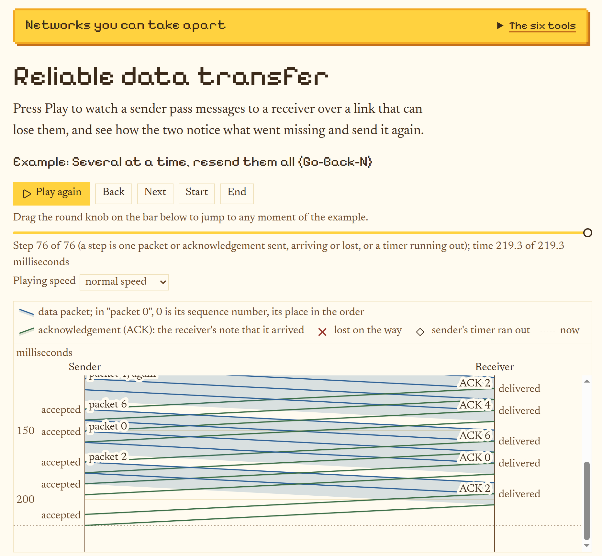

# net-visual

Network protocol simulations for teaching, from reliable data transfer to HTTP/3. Rust compiled to WebAssembly, with a React front end.



## Try it

Open the [live demo](https://varunswaika.github.io/net-visual/), or run it locally:

```sh
npm install && npm run dev    # http://localhost:5173
```

## What it does

- Six tools: reliable data transfer, TCP congestion control, routing, queueing and delay, the link layer and wireless, and naming and the web (DNS and HTTP).
- Each tool draws a seeded simulation written in Rust. The same seed always gives the same run.
- You can stop time, step back, drop or delay one packet, and change the protocol's rules.
- Each tool sets the run against the formula that predicts it. For example, stop-and-wait utilisation lands within 4% of its closed form.
- A link stores the exact moment, settings and packet edits. The sequence diagram exports as SVG or as TikZ for LaTeX.

[docs/tools.md](docs/tools.md) lists each tool's models and what the tests check them against.

## Build and test

You need Node 24, the version CI uses. To rebuild the WebAssembly module, you also need Rust with the `wasm32-unknown-unknown` target and `wasm-opt` (Binaryen).

```sh
make check        # npm ci, then build, then test
make test         # Rust model tests, then Node tests that load the real wasm
make lint         # eslint, prettier, clippy, rustfmt
make build        # type check and static site in dist/
npm run wasm      # rebuild src/net-visual/core/netsim.wasm after changing crates/
```

`netsim.wasm` is committed, built with `wasm-opt -Os`, and `npm run build` uses it as it is. After you change `crates/`, run `npm run wasm` and commit the result.

The Rust tests check each model against its closed form or the textbook figure it reproduces. The Node tests load the compiled module, run every preset and lab through it, and check that the guided tour stops where its text says.

## How it works

- `crates/netsim` is the simulation: a SplitMix64 generator, an event queue with integer microsecond times, and one module per tool. Each transmission draws exactly two random numbers, so editing one packet never changes the luck of the others.
- `crates/netsim-wasm` exposes it through a plain C interface with three functions (`nv_alloc`, `nv_free` and `nv_call`) that pass JSON. There is no wasm-bindgen.
- `src/net-visual` holds the typed TypeScript API, the share links, and the React components for each tool.
- `src/app` is a small stand-alone page for the demo. [docs/embedding.md](docs/embedding.md) explains how to mount the tools in another site.

## Licence

MIT. See [LICENSE](LICENSE).
